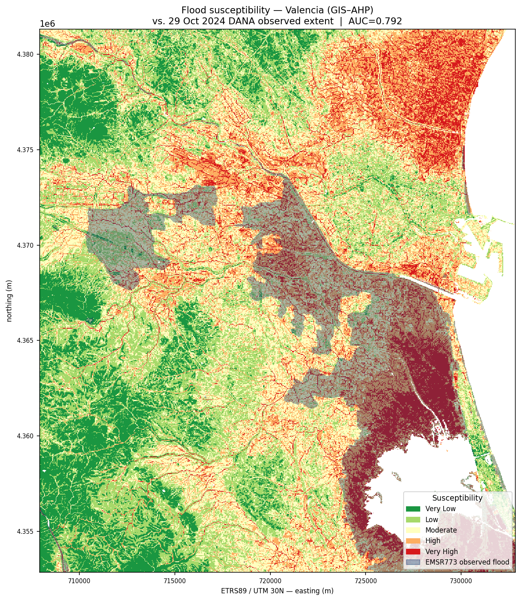

# Flood Susceptibility Mapping — Valencia, Spain (GIS–AHP)

Transferability test of a published GIS–AHP urban flood susceptibility
framework, applied to the Valencia region and validated against the
**observed** flood extent of the 29 October 2024 DANA event
(Copernicus EMS activation EMSR773).



**Test-AOI result (Horta Sud / lower Poyo ravine, 30 m grid):**
ROC AUC **0.79** against the satellite-derived observed flood extent;
**67.6 %** of the observed flood falls in the High + Very High classes
(the source study reports 67.8 % overlap with EU Floods Directive hazard
zones for its own area — but against *modelled* zones, not an observed
event).

## Research question

Can the GIS–AHP flood susceptibility framework of
[*Mapping Urban Flood Susceptibility to Support Climate Resilience: A
GIS–AHP Approach in a Mediterranean Metropolitan Context*
(Land 2026, 15(6), 1089, CC BY)](https://www.mdpi.com/2073-445X/15/6/1089),
developed for Thessaloniki, be transferred to the Valencia region — and how
well does its output correspond to the observed extent of the 2024 DANA
flood?

Most susceptibility studies validate against modelled hazard maps or sparse
historical point inventories. Valencia 2024 offers a wall-to-wall,
satellite-derived observed flood delineation, allowing a genuine ROC/AUC
assessment against ground truth.

## Method

Ten conditioning factors, each reclassified to a 1–5 susceptibility rating
and combined by weighted linear overlay with the paper's published AHP
weights (Table 2; pairwise matrix in Table A1 — re-solved here by principal
eigenvector, reproducing the published weights within ±0.005):

| Factor | Weight | | Factor | Weight |
|---|---|---|---|---|
| TWI | 0.259 | | NDVI | 0.071 |
| Slope | 0.169 | | NDBI | 0.056 |
| Drainage density | 0.140 | | Distance from roads | 0.035 |
| LULC | 0.125 | | Elevation (DEM) | 0.034 |
| Distance from streams | 0.089 | | Aspect | 0.020 |

Continuous factors are classified by Jenks natural breaks on the AOI's own
distribution; LULC and aspect follow the paper's ordinal schemes. The final
index is classified into five classes (Jenks) and validated against the
rasterised EMSR773 observed-event polygons (ROC/AUC + per-class flood
capture).

## Data (all open, all fetched by script)

| Layer | Source | License |
|---|---|---|
| DEM | Copernicus DEM GLO-30 (AWS Open Data) | © DLR/ESA, free use with attribution |
| Land cover | ESA WorldCover 2021 v200 | CC BY 4.0 |
| Streams, roads | OpenStreetMap via Overpass | ODbL |
| NDVI/NDBI | Sentinel-2 L2A COGs (Earth Search STAC) | Copernicus Sentinel data, free use |
| Validation | Copernicus EMS EMSR773 DEL observed event | © European Union, free use with attribution |

Optional: substitute the 5 m Spanish national DTM
([CNIG MDT05](https://centrodedescargas.cnig.es/CentroDescargas/modelo-digital-terreno-mdt05-primera-cobertura),
CC BY 4.0 scne.es) — drop the sheets into `data/raw/mdt05/` and set
`RESOLUTION = 5` in `config.py`.

## How to run

```bash
pip install -r requirements.txt
bash scripts/run_all.sh          # or run scripts/01…04 individually
```

Configuration (AOI, resolution, date windows) lives in `config.py`.
The default `TEST_AOI` covers the Horta Sud comarca and runs in a few
minutes; switch to `FULL_AOI` for the whole EMSR773 study area.

Scripts are plain Python (rasterio / geopandas / pysheds) so they run in any
environment, including QGIS's bundled interpreter. Final cartography is done
in QGIS desktop — see `qgis/README.md` and the layout template in
`layouts/`.

```
├── config.py            # AOI, grid, AHP matrix & weights — edit here
├── scripts/
│   ├── 01_fetch_data.py       # downloads every input (resumable)
│   ├── 02_preprocess.py       # ten factor rasters on a common grid
│   ├── 03_analysis.py         # AHP + reclassification + overlay
│   ├── 04_export_outputs.py   # validation, maps, stats
│   └── run_all.sh
├── layouts/             # QGIS print layout template (.qpt)
├── qgis/                # instructions to assemble the .qgz
├── data/                # raw/processed — gitignored, script-populated
└── outputs/             # maps, ROC curve, stats, reports — committed
```

## Deviations from the source paper

Declared per the paper's own framework-transfer intent:

1. **Study area**: Valencia (Turia/Magro/Poyo systems) instead of
   Thessaloniki.
2. **Validation**: observed satellite-derived flood extent (EMSR773) instead
   of historical flood points; metric is ROC/AUC + class capture.
3. **AHP weights**: the published weights are adopted unchanged
   (transferability test). The eigenvector solve of the published pairwise
   matrix is reproduced in `03_analysis.py` as verification (CR = 0.067 by
   the standard Saaty CI/RI formula; the paper reports 0.098).
4. **Land cover**: ESA WorldCover 10 m instead of CORINE 100 m (no
   registration required, finer resolution). WorldCover cannot separate
   industrial from residential built-up, so all built-up is rated 4
   (paper: industrial 4, other built-up 3).
5. **Class breaks**: Jenks breaks computed on this AOI's factor
   distributions rather than the paper's Thessaloniki-specific value ranges
   (Table A2), which do not transfer across regions.
6. **Permanent water masked**: the sea and the Albufera lagoon are excluded
   from the susceptibility map and validation (the Thessaloniki study area
   contained no comparable water bodies).
7. **Drainage density** approximated as stream length per unit area in a
   1 km circular moving window over the rasterised OSM network.
8. **Streams/roads from OSM** rather than EU-Hydro (registration-free,
   denser network — includes the artificial channels of the Horta Sud).
9. **DEM**: Copernicus GLO-30 by default (paper: 25 m national DEM);
   MDT05 5 m supported as a drop-in.

## References

- Land 2026, 15(6), 1089 — <https://www.mdpi.com/2073-445X/15/6/1089> (CC BY)
- Copernicus EMS EMSR773 — <https://rapidmapping.emergency.copernicus.eu/EMSR773/>
- Remote Sensing 2025, 17(13), 2145 — assessment of the Oct 2024 event
- JRC river flood hazard maps — <https://data.jrc.ec.europa.eu/collection/id-0054>

## License

Code: MIT. Map outputs and figures: CC BY 4.0. Input data remain under
their providers' licenses (see table above).
